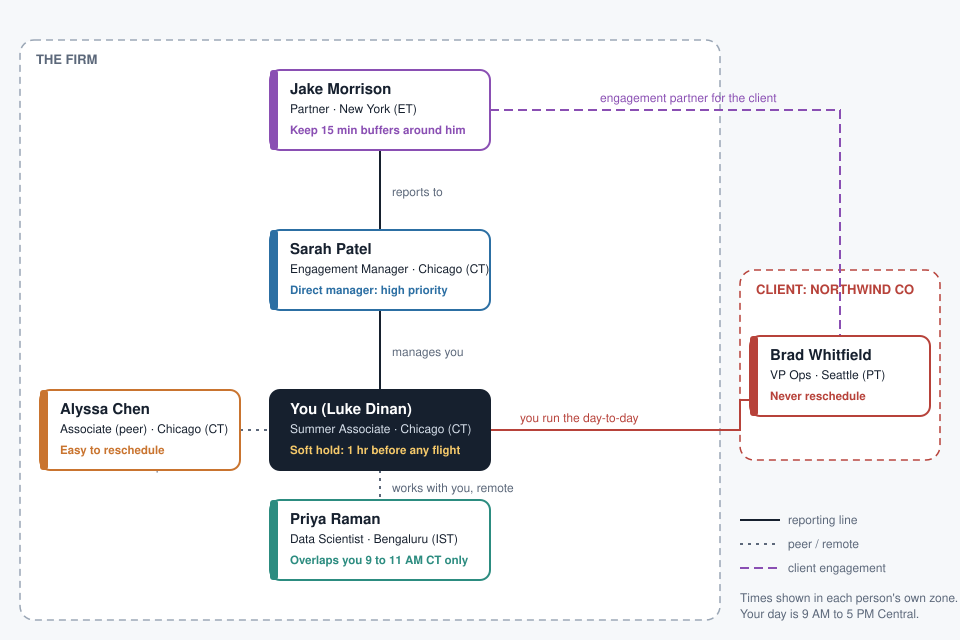
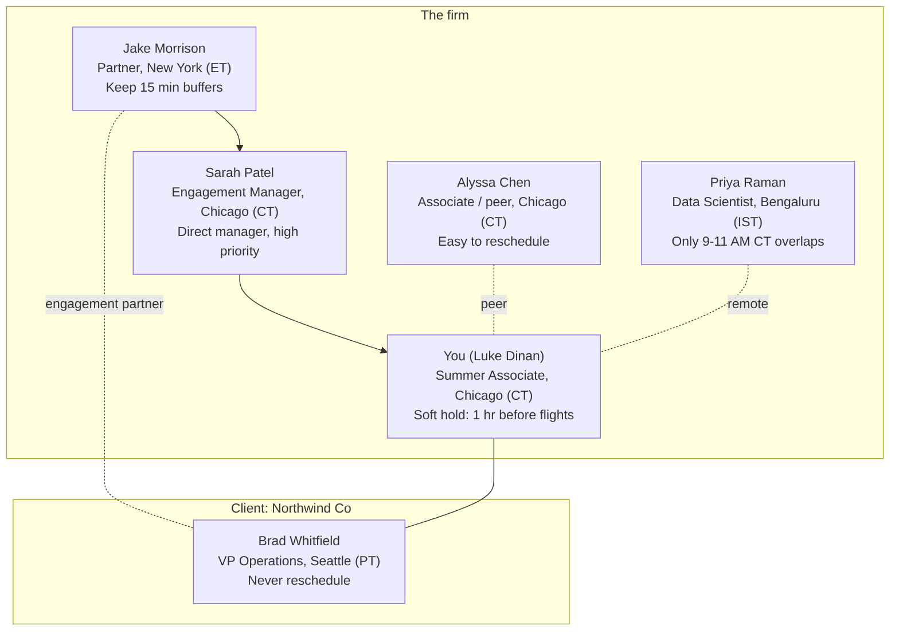

# Team structure (demo cast)

The six people in the demo and how they relate. The same cast has Outlook-style sample calendars in `src/data/graph/` and profile cards in the app's **What I know** panel.



The diagram is also in `documentation/team-structure.svg` (opens in any browser).

## Mermaid version



## Text version

```
THE FIRM
  Jake Morrison (Partner, New York, ET)
    |  reports to
  Sarah Patel (Engagement Manager, Chicago, CT)
    |  manages
  YOU (Chicago, CT) ---- peer ---- Alyssa Chen (Chicago, CT)
    |
    '--- works with, remote ---- Priya Raman (Bengaluru, IST)

CLIENT: NORTHWIND CO
  Brad Whitfield (VP Operations, Seattle, PT)
    - Jake is the engagement partner
    - you run the day-to-day
```

## How each person shapes scheduling

| Person | Role | Zone | What the assistant is taught | Effect |
|---|---|---|---|---|
| Jake | Partner | ET | High priority. Buffers around meetings with him | `buffer_rule` with `trigger.attendee`. New meetings are checked for 15 min of space in **his** calendar too. Jake is also the heaviest traveler in the data (5 flights), so travel days get a callout |
| Sarah | Direct manager | CT | High priority | Meetings with Sarah rate high, flexibility medium |
| Alyssa | Peer | CT | Meetings can be rescheduled with ease | Her meetings are the ones the assistant offers to bump, and it drafts the note |
| Brad | Client | PT | Never reschedule | `never_reschedule: true`, flexibility `none`. Never offered as a bump. Zoom link by default |
| Priya | Data scientist | IST | "Priya is in Bengaluru and only works 8 AM to 12 PM ET." | The mess in the demo: Priya's calendar settings say 9 AM to 6 PM India time, which never overlaps your day. What you taught (working hours in Eastern, location Bengaluru) overrides it, so only 9 to 11 AM Central works and every slot shows the Bengaluru time. Out of office Friday |
| You | Associate | CT | Flight rule | 60 minute soft hold before every flight, flags any meeting inside it |
